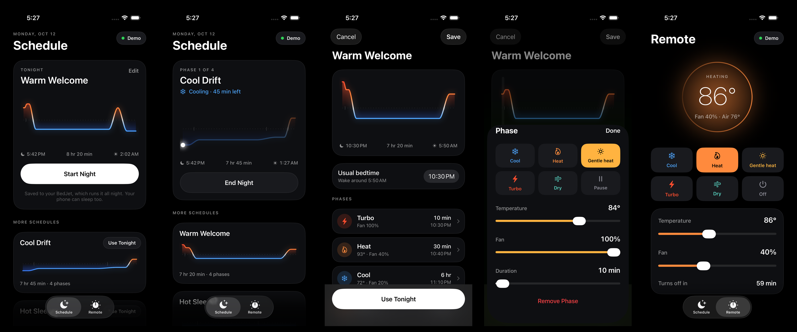

# Lull

Schedule your BedJet 3 or BedJet V2 through the night. No account, no cloud.



Lull is an iPhone and Android app that plans a whole night of heating and cooling for a BedJet 3 or
BedJet V2, saves it to the BedJet itself, and lets the BedJet run it. Your phone can sleep, leave the
room, or run out of battery; the night keeps going.

[App Store](https://apps.apple.com/us/app/lull-for-bedjet/id6822096696) ·
[Google Play](https://play.google.com/store/apps/details?id=com.rohankanjani.lull)

- **Schedules**: build a night out of phases (Cool, Heat, Gentle heat, Turbo, Dry, Pause), each with
  its own temperature, fan speed and duration, and see the whole curve at a glance.
- **Runs on the device**: tonight's schedule is written into one of a BedJet 3's three program slots, or into a
  BedJet V2's single sequence. The V2 has no Gentle heat or Dry, and only Heat has an adjustable temperature.
- **Remote**: a direct remote for mode, temperature, fan and shut-off timer.
- **History**: every change through the night, with the time and room temperature, so the morning
  after you can see what you picked and when.
- **Two phones, one BedJet**: the BedJet only accepts one connection, so Lull hands it over between
  phones automatically, iPhone or Android.
- **Private**: Bluetooth only. No accounts, analytics, or network calls.

> Lull is an independent project and is not affiliated with or endorsed by BedJet LLC.

## One app, two platforms

The iPhone app (Swift, SwiftUI) and the Android app (Kotlin, Jetpack Compose) are native ports of
each other and behave the same. **Every change lands in both in the same pull request.**
[AGENTS.md](AGENTS.md) has the rules and a file-by-file map between the two, and it's also what coding
agents read before working here.

## Repository layout

| Path | What it is |
| --- | --- |
| `Lull/` | The iPhone app in SwiftUI (model, schedules, views, theme) |
| `BedJetKit/` | Swift package: the BedJet 3 and V2 Bluetooth protocols, a CoreBluetooth transport, and a simulated BedJet 3 |
| `BedJetKit/Sources/bedjetctl` | A read-only command-line tool that prints a real BedJet's status and saved programs |
| `LullUITests/` | iPhone UI tests that walk the main flows against the simulated BedJet |
| `android/app/` | The Android app in Jetpack Compose, with its Bluetooth transport, unit tests and UI tests |
| `android/bedjetkit/` | Kotlin port of BedJetKit: the same protocols, simulated BedJet and tests |
| `fastlane/` | Release lanes for both stores, and both store listings (`metadata/` and `metadata/android/`) |
| `docs/BEDJET_V2_PROTOCOL.md` | The BedJet V2 protocol, how it was worked out, and what is still unconfirmed |
| `screenshots/`, `app-store-screenshots/` | Marketing and App Store screenshots |

## Getting started

### iPhone

Requirements: Xcode 16 or later, iOS 18 or later for the app. BedJetKit also builds on macOS 14.

```bash
git clone https://github.com/rkanjani/lull.git
cd lull
open Lull.xcodeproj
```

In Xcode, select the **Lull** target, open **Signing & Capabilities**, choose your own team, and change
the bundle identifier to something unique (for example `com.yourname.lull`). Then run.

**No BedJet? No problem.** The iOS Simulator has no Bluetooth, so the app uses a simulated BedJet
(`DemoLink`) that speaks the same bytes as the real one. You can also turn on Demo mode on a device.

### Android

Requirements: JDK 17 and the Android SDK (Android Studio installs both). The app runs on Android 12 or later.

Open the `android/` folder in Android Studio and run the **app** configuration, or from a terminal:

```bash
cd android
./gradlew :app:installDebug
```

Like the iOS Simulator, the Android emulator always uses the simulated BedJet. On a phone, Lull asks for
the Nearby devices permission to reach your BedJet, and Demo mode works there too.

### Running tests

```bash
# Protocol and codec tests
cd BedJetKit && swift test
```

UI tests run from Xcode (**Product → Test**) or with:

```bash
xcodebuild test -project Lull.xcodeproj -scheme Lull -destination 'platform=iOS Simulator,name=iPhone 17 Pro'
```

On Android, the same protocol tests plus the app's unit tests:

```bash
cd android && ./gradlew :bedjetkit:test :app:testDebugUnitTest
```

and the UI tests, with an emulator running or a phone plugged in:

```bash
cd android && ./gradlew :app:connectedDebugAndroidTest
```

### Talking to a real BedJet from your Mac

```bash
cd BedJetKit && swift run bedjetctl
```

`bedjetctl` connects to the first BedJet it finds, prints its status, name, firmware and saved
programs, then exits. It changes nothing on the device.

## Releasing

Pushes to `main` are built and submitted to the App Store and Google Play by GitHub Actions. Both apps
share one version number. See [docs/RELEASING.md](docs/RELEASING.md).

## Contributing

Contributions are welcome: bug reports, protocol findings, fixes and features. Read
[CONTRIBUTING.md](CONTRIBUTING.md) for how to set up, the code style, and how to open a pull request.

To report a security issue, see [SECURITY.md](SECURITY.md) rather than opening a public issue.
Lull's privacy policy is in [PRIVACY.md](PRIVACY.md).

## License

[MIT](LICENSE)
